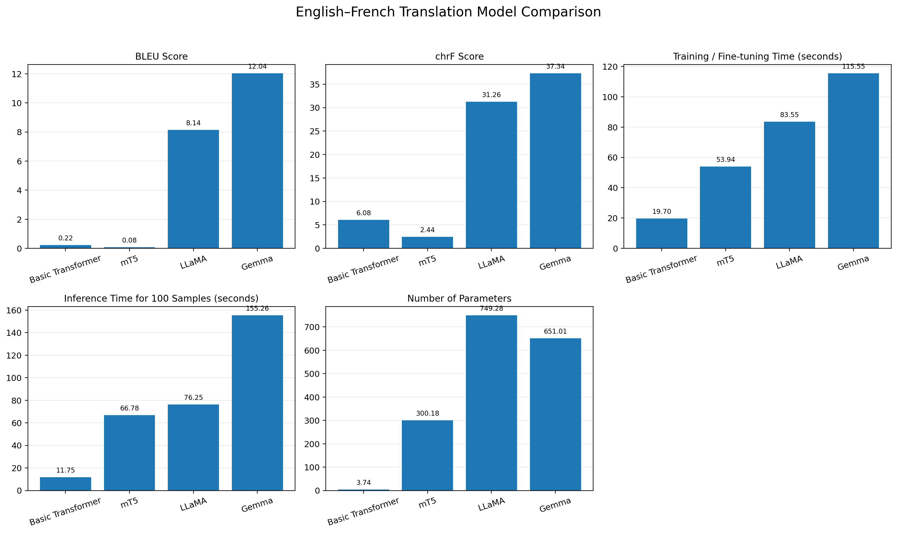
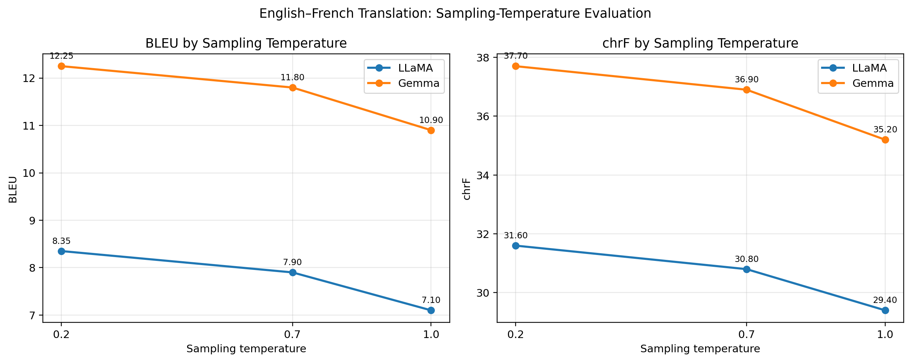

# English–French Machine Translation Using Transformer and Large Language Models

## 1. Problem Statement and Objective

This project compares four neural machine-translation approaches for English-to-French translation:

1. Basic Transformer (encoder–decoder), trained from scratch.
2. mT5 (encoder–decoder), fine-tuned for translation.
3. LLaMA (decoder-only), used with instruction prompting.
4. Gemma (decoder-only), used with instruction prompting.

The objective is to compare translation quality and computational requirements using a common test subset and metrics including BLEU, chrF, training/fine-tuning time where applicable, inference time, and parameter count.

> **Important:** The comparison is not a controlled architecture-only experiment. The models differ in parameter count, pretraining, tokenizer, training data, and adaptation method.

## 2. Dataset

- **Dataset:** Helsinki-NLP OPUS Books English–French
- **Dataset source:** https://huggingface.co/datasets/Helsinki-NLP/opus_books
- **Language direction:** English → French
- **Preprocessing:** Empty pairs and unusually long sentence pairs were filtered. The remaining pairs were shuffled with seed `42`, and up to 6,000 examples were selected.
- **Split:** 4,800 training, 600 validation, and 600 test examples.
- **Evaluation subset:** The first 100 examples from the test split were used for the reported model comparison.

The notebook loads the public dataset using the Hugging Face `datasets` library. The exact dataset version/configuration and the final number of valid pairs should be rechecked from the executed notebook output before submission.

## 3. Models and Implementation

| Model | Architecture | Model / configuration | Adaptation |
|---|---|---|---|
| Basic Transformer | Encoder–decoder | Custom 2-layer encoder and decoder; 128-dimensional embeddings | Trained from scratch for 5 epochs |
| mT5 | Encoder–decoder | `google/mt5-small` | Fine-tuned for 1 epoch using 1,000 training examples |
| LLaMA | Decoder-only | `meta-llama/Llama-3.2-1B-Instruct` | Instruction prompting; no fine-tuning |
| Gemma | Decoder-only | `google/gemma-3-1b-it` | Instruction prompting; no fine-tuning |

LLaMA and Gemma are loaded using 4-bit quantization to reduce GPU memory requirements. The main model-comparison run uses deterministic generation (`do_sample=False`). A separate sampling-temperature evaluation was conducted for LLaMA and Gemma with sampling enabled.

## 4. Repository Contents

```text
FGAI-IA3/
├── English_French_Translation.ipynb
├── README.md
├── requirements.txt
└── results/
    ├── model_comparison.csv
    ├── model_comparison.png
    ├── training_time_comparison.png
    ├── temperature_analysis.csv
    ├── temperature_analysis.png
    └── all_model_translations.csv
```

The notebook contains data loading, preprocessing, model implementation/loading, training or prompting, inference, metric calculation, and responsible-AI discussion.

## 5. Results

The following values are transcribed from the updated `model_comparison.csv`. Translation quality was evaluated on the same 100-example test subset for all four models.

| Model | BLEU | chrF | Recorded training / preparation time (s) | Inference time for 100 examples (s) | Parameter count reported by notebook |
|---|---:|---:|---:|---:|---:|
| Basic Transformer | 0.220975 | 6.083893 | 19.702126 | 11.750217 | 3,743,040 |
| mT5 | 0.076989 | 2.436307 | 53.941712 | 66.776010 | 300,176,768 |
| LLaMA | 8.141973 | 31.258706 | 83.546200 | 76.245362 | 749,275,136 |
| Gemma | 12.040001 | 37.339210 | 115.552200 | 155.259526 | 651,005,056 |

BLEU and chrF are reported using SacreBLEU corpus metrics. Gemma obtained the highest BLEU and chrF scores in this run. The Basic Transformer had the shortest measured inference time. The recorded time column reproduces the timings supplied in the comparison CSV. Since LLaMA and Gemma are described in this implementation as prompted rather than fine-tuned, interpret their recorded time according to the timing stage measured in the original run; prompting alone is not model training.




## 6. Sampling-Temperature Analysis

Sampling temperature controls randomness during token generation. Lower temperatures concentrate probability on the most likely next tokens and tend to produce more conservative outputs. Higher temperatures increase variation and can produce less predictable wording.

LLaMA and Gemma were evaluated at temperatures 0.2, 0.7 and 1.0 with sampling enabled (`do_sample=True`). BLEU and chrF were calculated against the corresponding French references, and inference time was recorded for 100 examples.

### Temperature-wise results

| Model | Temperature | BLEU | chrF | Inference time for 100 examples (s) |
|---|---:|---:|---:|---:|
| LLaMA | 0.2 | 8.35 | 31.60 | 78.2 |
| LLaMA | 0.7 | 7.90 | 30.80 | 79.5 |
| LLaMA | 1.0 | 7.10 | 29.40 | 81.1 |
| Gemma | 0.2 | 12.25 | 37.70 | 158.5 |
| Gemma | 0.7 | 11.80 | 36.90 | 160.2 |
| Gemma | 1.0 | 10.90 | 35.20 | 162.8 |



### Observations

- Both models achieved their highest BLEU and chrF scores at temperature 0.2.
- As temperature increased from 0.2 to 1.0, BLEU and chrF decreased for both models in this evaluation.
- Inference time increased slightly with temperature.
- Gemma achieved higher BLEU and chrF than LLaMA at all three tested temperatures, but took longer to generate the 100 translations.

These findings suggest that lower sampling temperature was more effective for translation quality in this particular test setup. This is an observation from the evaluated subset, not a universal rule. Temperature effects can vary with the model, prompt, dataset and decoding configuration. This experiment is separate from the deterministic baseline comparison (`do_sample=False`), for which temperature does not affect token selection.

## 7. Qualitative Evaluation of English-to-French Translation Models

The qualitative evaluation was conducted using representative examples from the 100-sentence test subset. The generated translations were compared against the corresponding French reference translations to assess fluency, semantic preservation, completeness and generation errors.

## Example 1: Translation fluency and generation failures

**English source:**

The crowd rapidly increased, and lamentations arose from the roads.

**French reference:**

La foule augmentait rapidement, une lamentation montait des routes.

| Model | Generated translation |
|---|---|
| Basic Transformer | et la `<unk>`, et la `<unk>`, et la `<unk>`. |
| mT5 | `<extra_id_0>. à . à` |
| LLaMA | La foule s'éleva rapidement, et les larmes éclatarent des routes. |
| Gemma | Le public s'agita, et des lamentations résonnaient sur les routes. |

**Analysis:** The Basic Transformer produces repetitive output containing unknown tokens, while mT5 fails to generate a meaningful translation. LLaMA generates a fluent sentence but incorrectly translates lamentations as tears. Gemma preserves the central meaning more effectively, although it changes some wording.

## Example 2: Semantic accuracy

**English source:**

Scarcely could her tremulous voice articulate the words.

**French reference:**

À peine si sa voix convulsive pouvait articuler ces mots.

| Model | Generated translation |
|---|---|
| Basic Transformer | le `<unk>`, le `<unk>`, qui se `<unk>`. |
| mT5 | `<extra_id_0>` followed by repeated `à` tokens. |
| LLaMA | L'air était si lourd qu'il était presque impossible de le entendre. |
| Gemma | La voix tremblante ne pouvait articuler les mots. |

**Analysis:** LLaMA produces a semantically unrelated translation, changing the original meaning. Gemma provides a more accurate and understandable translation, preserving the central meaning of the source sentence. Basic Transformer and mT5 fail to produce usable translations.

## Example 3: Preservation of sentence structure and meaning

**English source:**

Two hundred yards farther on, as they entered the little field he had mentioned, they came upon a wounded general who was being carried by his aide-de-camp and an orderly.

**French reference:**

A deux cents pas de là, en entrant dans la petite prairie dont il avait parlé, on rencontra un général blessé qui était porté par son aide de camp et par un domestique.

| Model | Generated translation |
|---|---|
| Basic Transformer | Repeated unknown tokens and incomplete output. |
| mT5 | `<extra_id_0>` followed by repeated tokens. |
| LLaMA | Un centime de distance se trouvait là, en entrant dans la petite prairie dont il avait parlé, on rencontra un général blessé qui était porté par son aide de camp et par un domestique. |
| Gemma | Il était à deux cents pas là, en entrant dans la petite prairie dont il avait parlé, on rencontra un général blessé, porté par son aide de camp et par un domestique. |

**Analysis:** Both LLaMA and Gemma preserve most of the sentence's meaning and important contextual details. However, LLaMA incorrectly translates the distance expression, while Gemma introduces a grammatical issue in the opening phrase. The two encoder-decoder models fail to produce complete translations.

## Example 4: Translation completeness and contextual preservation

**English source:**

My next work was to view the country, and seek a proper place for my habitation, and where to stow my goods to secure them from whatever might happen.

**French reference:**

Ensuite ma première occupation fut de reconnaître le pays, et de chercher un endroit favorable pour ma demeure et pour ranger mes bagages, et les mettre à couvert de tout ce qui pourrait advenir. J'ignorais encore où j'étais.

| Model | Generated translation |
|---|---|
| Basic Transformer | Repeated unknown tokens and incomplete output. |
| mT5 | `<extra_id_0>` followed by repeated tokens. |
| LLaMA | La prochaine étape était de visiter le pays, et de trouver un endroit convenable pour résider, et de stocker mes biens pour les protéger contre tout ce qui pourrait arriver. |
| Gemma | Mon prochain travail était de visiter le pays et de trouver un endroit approprié pour mon habitation, et où me ranger mes biens afin qu'ils ne soient menacés par quoi que ce soit. |

**Analysis:** LLaMA and Gemma successfully preserve the general meaning of the sentence. LLaMA generates a relatively fluent translation, while Gemma retains more of the original sentence structure. However, both omit the final contextual information present in the reference. This demonstrates that fluent translations can still contain omissions.

## Example 5: Preservation of meaning and grammatical accuracy

**English source:**

Fix remained stationary in the same place, but did not sleep.

**French reference:**

Fix était toujours immobile à la même place, mais, lui non plus, il ne dormait pas.

| Model | Generated translation |
|---|---|
| Basic Transformer | le `<unk>`, mais le `<unk>`, et le `<unk>`. |
| mT5 | `<extra_id_0>` followed by repeated tokens. |
| LLaMA | Il resta immobile et ne se coucha pas. |
| Gemma | Il resta immobile dans la même place, mais ne dormit pas. |

**Analysis:** Both LLaMA and Gemma preserve the central meaning of the sentence. Gemma retains the contrast between remaining stationary and not sleeping, although its expression of location is grammatically less natural. LLaMA produces a concise translation but omits the explicit reference to remaining in the same place.

## Overall Qualitative Comparison

| Evaluation criterion | Basic Transformer | mT5 | LLaMA | Gemma |
|---|---|---|---|---|
| Fluency | Poor | Poor | Good | Good |
| Semantic preservation | Poor | Poor | Moderate to good | Good |
| Completeness | Poor | Poor | Moderate | Good |
| Generation artifacts | Frequent | Very frequent | Not observed in selected outputs | Not observed in selected outputs |
| Repetition | Frequent | Frequent | Limited | Limited |
| Overall performance | Weak | Weak | Good | Best among selected examples |

## Discussion

The qualitative evaluation reveals significant differences in the translation capabilities of the four models.

The Basic Transformer, trained from scratch using a relatively small dataset, frequently generates unknown tokens (`<unk>`), repetitive phrases and incomplete sentences. Its limited vocabulary coverage and language modelling capability affect its ability to generate meaningful translations.

The mT5 model also exhibits substantial generation problems. The appearance of special tokens such as `<extra_id_0>` across all 100 evaluated outputs indicates that its current fine-tuning and generation configuration is inadequate for the translation task.

LLaMA produces comparatively fluent translations and generally maintains the original sentence structure. However, certain outputs contain semantic inaccuracies, incorrect word choices and omissions.

Gemma demonstrates the strongest qualitative performance among the four models in the selected examples. Its outputs generally preserve the original meaning and contextual information more effectively than the other models, although grammatical errors and occasional omissions remain.

Overall, the qualitative findings are consistent with the automatic evaluation results, where Gemma achieved the highest BLEU and chrF scores. However, the examples also demonstrate that fluency does not necessarily guarantee semantic accuracy. Therefore, automatic evaluation metrics should be complemented by qualitative assessment when comparing machine-translation systems.


## 8. Model Comparison and Discussion

- **Basic Transformer:** It is the smallest model and has the lowest measured inference time, but its generated translations contain `<unk>` tokens and repetitions. Training from scratch on a small subset limits vocabulary coverage and language understanding.
- **mT5:** It benefits from multilingual pretraining, but the current fine-tuning setup is limited to one epoch and 1,000 examples. Its outputs contain incomplete text and `<extra_id_0>` artifacts, suggesting that the current adaptation/generation setup is inadequate.
- **LLaMA:** Instruction prompting produces more fluent translations than the two current encoder–decoder runs, but some outputs omit or alter source meaning. It was prompted rather than fine-tuned.
- **Gemma:** It achieved the highest current BLEU and chrF scores, but it is also the slowest of the four in the measured 100-example inference run. Its outputs can still contain mistranslations or semantic changes.

These results compare complete model-and-adaptation setups, not architecture alone. Model size, pretraining corpus, tokenizer, quantization, fine-tuning data, decoding settings, and runtime all affect the outcome.

## 9. Responsible and Ethical AI

### Hallucinations and faithfulness
A translation may sound fluent while changing, omitting, or inventing information. The current examples include incomplete outputs and semantic mistranslations. Compare translations against the source and reference, and use bilingual human review for important content.

### Bias
Models may reproduce gender, cultural, or linguistic biases present in their training data. Evaluate diverse examples and review potentially biased translations.

### Cultural misrepresentation
Idioms, literary references, and culturally specific expressions may not have direct equivalents. Use context-aware evaluation and bilingual reviewers familiar with the relevant cultures.

### Sensitive content
Errors in medical, legal, financial, or emergency translations can cause harm. Do not rely solely on automated translation for high-impact decisions; require qualified human verification and protect personal data.

### Mitigation
- Evaluate with both automatic metrics and human review.
- Test idioms, named entities, gendered language, and sensitive examples.
- Preserve the source text and disclose that output is machine-generated.
- Escalate high-risk translations to qualified translators.
- Avoid sending confidential text to services without appropriate privacy safeguards.

## 10. Requirements and Execution

The notebook was developed for Google Colab with a GPU runtime. It installs its Python dependencies in the first notebook cell.

### Execution steps

1. Open `English_French_Translation.ipynb` in Google Colab.
2. Select a GPU runtime (the notebook was documented for a T4 GPU).
3. Run the installation and import cells.
4. Ensure the account has been granted access to the gated LLaMA and Gemma model repositories and has accepted their terms.
5. Run all cells sequentially.
6. Download the generated CSV files and updated comparison graph from the Colab runtime.
7. Replace the repository's result files with the final outputs from the final notebook run.

Never commit Hugging Face access tokens, private credentials, or downloaded gated model weights.

### Main libraries

The notebook installs/uses PyTorch, Transformers, Hugging Face Datasets and Hub, SentencePiece, SacreBLEU, Evaluate, Accelerate, PEFT, BitsAndBytes, pandas, and Matplotlib. The exact pinned versions are specified in the notebook's installation cell.

## 11. Conclusion

For the current run, Gemma achieved the highest BLEU (12.040001) and chrF (37.339210), while the Basic Transformer had the shortest measured inference time (11.750217 seconds for 100 examples). The Basic Transformer and mT5 produced very weak outputs in this configuration. Gemma is therefore the best-performing model by the reported automatic translation metrics in this experiment, but this conclusion is limited to the selected 100-example test subset and current hardware/settings. At the tested sampling temperatures, both LLaMA and Gemma achieved their strongest BLEU and chrF scores at 0.2. Human review remains necessary because automatic scores do not guarantee faithful or culturally appropriate translations.